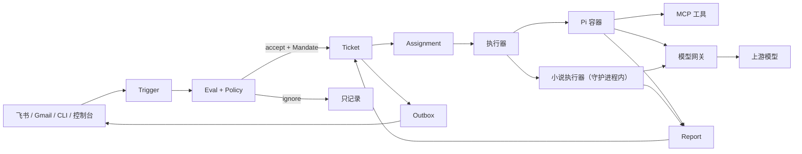

# superagent

> A self-hosted AI workbench: a sentence goes in, a ticket comes out, the work runs in a sandbox, and the result comes back with evidence.
>
> 自托管的 AI 工位：一句话进来，一张工单出去；在隔离沙箱里干完，按目标验收，再把结果送回原处。

superagent 是给**一个人**用的 AI 任务系统，不是聊天框，也不是多租户 SaaS。它把飞书、Gmail、命令行和控制台里的请求变成一张张**工单**：先过规则和预算，再进 rootless Podman 容器执行，最后把结果、花费和过程记录交回原处。适合长时间跑的开发任务、需要多模型协作的分析，以及按弧推进的长篇小说。

## 为什么是工单，而不是对话

| 原则 | 落到代码里 |
| --- | --- |
| **少打扰** | 只在需要你决定、或有结果时说话；一次只问一个具体问题 |
| **代码把关** | 谁能派活、能花多少、能碰哪些文件，由 policy、预算和沙箱决定，不靠提示词 |
| **可恢复** | SQLite 账本 + 持久化 effects/outbox + 章节检查点，重启后接着跑 |
| **可审计** | 每条触发、每次受理、每份报告、每笔模型调用都有记录 |
| **成本可见** | 按票、按角色、按天统计 token、缓存命中和美元花费 |

## 功能一览

| 能力 | 说明 |
| --- | --- |
| **多渠道接活** | 飞书长连接/回调、Gmail（IMAP/SMTP）、`sa` CLI、Web 控制台 |
| **工单内核** | 去重、规则评估、授权 Mandate、停止/重试/追问、事件与账本 |
| **隔离执行** | 每票一个 rootless Podman 容器，只读根文件系统，网络只放行网关和 MCP 两个回环端口 |
| **多模型协作** | 主 AI 按需派侦察/规划/审查/顾问/帮手，支持单个、并行、串联；按角色记账 |
| **目标验收** | 在执行者容器里跑验收命令，再加 AI 逐条判定；轮数、花费、时长都有上限 |
| **长篇小说** | 仙侠/玄幻书库，书 → 卷 → 弧 → 章；确定性章节流水线、设定校验、导出 TXT |
| **番茄发布** | 勾选章节存草稿、直接发布或定时发布；Cookie 失效会提示更新 |
| **模型网关** | 多服务商、多模型；每票独立令牌；预算、价格、用量和缓存命中 |
| **实时控制台** | React 单页，SSE 推送；今日工位、任务过程、书库、花费、设置 |
| **项目与会商** | ZIP 上传/解压/档案、五角色会商出任务书、密钥库、网页预览、GitHub PR、备份 |

## 核心流程



一张工单从受理到结束：

1. **接活**：Source 读消息，丢弃 bot 自己发的，按 trigger 去重。
2. **判断**：确定性 gate 先过滤；需要时再让研判模型判断是否接、怎么接。
3. **授权**：生成不可变 Mandate，记下规则版本、来源、发起人和范围。
4. **执行**：按 `maxSlots` 起容器；工作区、密钥、模型和令牌都按这张票注入。
5. **验收**：如果有目标，先跑验收命令，再由判定模型核对证据；没达成就把差距发回执行者。
6. **交付**：报告写进账本，Outbox 把结果发回原渠道；任务结束，花费可查。

## 功能详解

### 1. 接活：飞书、Gmail、CLI、控制台

- **飞书**支持长连接和 HTTP 回调两种模式；群里默认只处理 @ 机器人的消息，也可以配置为接收全部消息。
- **Gmail** 用 IMAP 轮询收信、SMTP 回信；只接受白名单发件人，附件有大小限制。
- **CLI** 的 `sa ask` 直接走本机控制端口；`sa tickets`、`sa ticket <id>`、`sa answer`、`sa stop`、`sa retry`、`sa project ...`、`sa council ...` 覆盖常用操作。
- **控制台**的「发任务」可以选择通用任务或写小说，指定项目、模型、密钥、目标、是否开启协作。

### 2. 工单、规则与预算

- 规则在「设置 → 规则」里配置：哪些来源、哪些人、哪些群可以派活，是否需要研判，哪些情况只记录。
- 同一 trigger 被接受两次也只建一张工单；任务停止后不能被普通消息悄悄恢复。
- 支持停止、重试、回答结构化问题、追加备注；所有动作进事件流。
- 预算分单票上限和每日上限；网关在超限时返回 402，worker 拿不到上游密钥。

### 3. 隔离执行

- 每张票一个 `sa-<ticketId>` 容器，rootless Podman，`--read-only`、`--no-new-privileges`、PID 限制。
- 容器只挂载这张票的工作区和临时目录；state 目录不挂进去，worker 读不到数据库、口令和 CLI token。
- 网络用 pasta，只把网关和 MCP 两个端口从容器回环转发到主机回环；后台端口和主机上的其它服务都连不上。
- 每个任务有独立工作区，删除任务时可选择是否保留文件。

### 4. 多模型协作

主 AI 在任务里通过 `subagent` 工具决定何时叫谁：

| 角色 | 能做什么 | 默认权限 |
| --- | --- | --- |
| 侦察 | 大范围找代码、配置、资料，交回路径、行号和结论 | 只读 |
| 规划 | 读代码后给实现方案、步骤、验证方法和风险 | 只读 |
| 审查 | 交付前审改动，可运行只读命令（`git diff`、测试） | 只读 + 命令 |
| 顾问 | 只回答难题和方案取舍，不看文件 | 只提问 |
| 帮手 | 批量改名、补测试、改格式等机械改动 | 可写，一次一个 |

- 每个角色可以单独指定模型；不指定就跟随任务模型。
- 子代理的令牌带 `.<角色>` 后缀：网关按角色记账，工人 MCP 端点拒绝带后缀的令牌。
- 只有可写角色能拿到这张票授权的密钥；子进程看不到 `sa_*` 工具，也不能继续派活。
- 控制台能看到每个子代理在干什么，任务详情里按角色列出花费。

### 5. 目标验收：没达成就不结束

- 发任务时可以写目标，并配一行条验收命令（在执行者容器内的 `/workspace` 运行）。
- 执行者报 `ready` 时，宿主先跑命令，再让判定模型逐条核对证据；没通过就记一轮，把「差什么」发回去继续干。
- 判定方式可选：命令 + AI、只看命令、只用 AI。
- 轮数、花费、时长三个上限（默认 8 轮 / $3 / 6 小时）；到上限就停下来问你，回复「继续」可以再给一批。
- 一轮结束却没交付，宿主会推它继续，而不是让任务挂着不动。

### 6. 写小说：从一句灵感到完本

这是仓库里最完整的垂直应用，用来验证「确定性流程 + 模型生成」而不是「让模型自己决定流程」。

- **书库**：一句灵感开书，先生成设定书（世界观、人物、境界、物品、伏笔、卷弧规划），确认后才开第一张工单。
- **一弧一票**：每写一弧开一张工单，照常走 Eval、Mandate、预算和渠道通知；小说票和普通任务在同一个列表里。
- **逐章流水线**：`contract → draft → lint → review → revise → extract → validate → commit`，代码控制每一步，模型只产出合同、正文、审稿和增量。
- **硬校验**：死人出场、境界倒退、物品不存在、时间倒流、伏笔错乱等事实错误不会提交；审稿意见则按严重程度处理，不会卡死整本书。
- **可恢复**：每章每步写检查点，提交前存快照；守护进程重启后从断点继续。
- **可控成本**：规划、写手、审稿、抽取可以分别配模型；每章有 token 预算，弧、书和每日有美元上限。
- **可修改**：阅读页可以提修改意见、撤销上一版；「待你看」的章节会标出原因。
- **可导出**：按书导出 TXT；已完成的章节可以同步到番茄。

### 7. 番茄发布

- 在「密钥」里保存浏览器抓到的 `FANQIE_COOKIE`，控制台只显示是否有效，不显示值。
- 绑定番茄作品后，可以勾选章节：存草稿（推荐）、直接发布、或定时发布。
- 每章同步状态（未同步/草稿/已发布/定时/正文有更新/失败）都有记录；登录失效会停止同步并提示更新 Cookie。
- 只使用账号主人提供的 Cookie，不模拟登录，也不绕过验证码。

### 8. 控制台

新控制台是 React + Vite 单页，服务端直接托管构建产物，不需要 Node 运行时构建：

- **今日**：等你回答、工位实况、最近结束、今日花费、上游状态。
- **任务**：按状态筛选、搜索、批量删除；任务页有过程、文件、目标卡、协作、密钥、预览和事件。
- **书库**：进度、字数、成本、下一弧、章节阅读与修改。
- **会商**：多角色讨论并产出任务书，可直接按任务书开工。
- **管理**：花费、密钥、连接、Pi 版本、规则、模型、预算、账号、系统、备份。
- **实时**：`/api/live/stream` 用 SSE 推送今日看板；断线时自动退回 5 秒轮询。
- 旧版后台仍保留在 `/legacy/`，设置 `SA_WEB=legacy` 可以把它切回根路径。

### 9. 模型网关与预算

- 服务商和模型在「设置 → 模型」里配置，支持 OpenAI 兼容接口和 Anthropic Messages 接口。
- worker 的 `models.json` 里只有网关地址和这张票的令牌，没有真实密钥。
- 网关按请求里的 model 查价，记录输入/输出、缓存命中、延迟和美元花费；超预算返回 402。
- 协作、目标判定、会商、小说都走同一套账本；任务详情可以按 `主 AI / 侦察 / 审查 / 目标` 分项查看。

### 10. 项目、会商、密钥、预览与备份

- **项目库**：上传 ZIP，安全解压，生成目录/依赖/入口档案；任务可以绑定项目。
- **会商**：需求分析师、架构师、实现工程师、测试与验收、风险与安全五个席位，加一个主持人；可各配模型。
- **密钥库**：AES-256-GCM 加密保存，按任务授权；出站文本统一脱敏。
- **网页预览**：任务可以开临时端口，控制台生成预览链接。
- **GitHub**：按票授权仓库，任务可创建 PR；PAT 只出现在请求头，错误信息会擦除令牌。
- **备份**：启动时和每小时检查，SQLite 用 `VACUUM INTO` 做一致快照；备份不含 CLI token 和每票 Pi 配置。

## 快速开始

要求：Node.js 22.19+、pnpm 10。真实沙箱还需要 Linux + rootless Podman 和 Pi 1.5.x。

```sh
pnpm install
pnpm check          # 类型检查 + Vitest
```

用假执行器在本地跑起来（不需要容器和模型密钥）：

```sh
# 终端 1
node --experimental-transform-types src/daemon.ts --config examples/config.local.json

# 终端 2
node --experimental-transform-types src/cli/sa.ts ask "列出当前目录的文件" --wait
```

开发配置的 `stateDir` 是 `.superagent`，CLI 要在同一个目录下运行（或设置 `SA_STATE_DIR`）。控制台的 `adminPort` 默认是 `0`（随机端口）；想固定地址就在配置里加 `"adminPort": 8787`，然后打开 `http://127.0.0.1:8787`。首次启动会在日志里打印一次性的管理口令。

生产部署（rootless Podman + systemd + 真实模型）见 [`deploy/README.md`](deploy/README.md)。

### 构建控制台

构建产物已经提交在 `src/admin/web-next/`，平时不用重新构建。改了 `web/src/` 后：

```sh
cd web
pnpm install
pnpm build          # 输出到 ../src/admin/web-next
```

## 配置

`examples/config.local.json` 是开发配置，`examples/config.debian.json` 是部署形状。关键字段：

| 字段 | 作用 |
| --- | --- |
| `stateDir` | 数据库、设置、密钥、令牌、书库的根目录；不要放进仓库 |
| `maxSlots` | 同时执行的任务数 |
| `adminPort` | 控制台端口；`0` 表示随机 |
| `operatorId` | 默认操作者 id，用于 CLI 来源的白名单 |
| `deepseekApiKeyEnv` | 保存上游密钥的环境变量名；配置文件里不写密钥本身 |
| `launcher` | 执行器命令和参数；默认 `pi --mode rpc` |
| `policy` | 初始受理规则；之后可在控制台修改 |

运行期的模型、预算、飞书、邮箱、GitHub、预览、小说、协作、目标等设置都在控制台里，保存到 `state/options.json`，不进仓库。

## 安全模型

- **单人边界**：默认只有一个操作者；没有多租户隔离，不要把控制台直接暴露到公网。
- **控制台**：只监听 `127.0.0.1`；管理口令用 scrypt 哈希保存；登录有限流；CLI 用 `state/cli-token`。
- **沙箱**：rootless、只读根文件系统、`no-new-privileges`、PID 限制；只放行网关和 MCP 两个回环端口。
- **令牌**：每票一个随机令牌，票结束即失效；子代理令牌带角色后缀，工人 MCP 拒绝带后缀的令牌。
- **密钥**：AES-256-GCM 加密；主密钥来自 `SA_VAULT_KEY` 或 `state/vault.key`；只向被授权的任务导出，出站文本统一脱敏。
- **外部凭据**：GitHub PAT 只在请求头里出现，错误信息会擦除；Gmail 用应用专用密码；番茄用账号主人提供的 Cookie。
- **仓库卫生**：`state/`、`cli-token`、`pi-config/`、`.env`、日志和备份都在 `.gitignore` 里。

## 目录结构

```text
src/
  core/          移植的领域内核：Source、Trigger、Thread、Eval、Mandate、Ticket、Assignment
  runtime.ts      把来源、引擎、网关、执行器、MCP、控制台和 outbox 接起来
  sources/        飞书、Gmail、CLI
  executor/       Pi RPC、容器启动、协作扩展、Pi 版本管理
  goal/           目标关卡：验收命令、AI 判定、轮数/花费/时长上限
  novel/          书库、章节状态机、设定校验、上下文、导出
  fanqie/         番茄作者后台客户端与同步记录
  gateway/        按票模型网关、价格、用量
  mcp/            工人侧 MCP 工具
  admin/          后台 API、鉴权、密钥库、备份、预览、项目
  admin/web/      旧版控制台（保留在 /legacy/）
  admin/web-next/ 新版控制台构建产物
  council/        五角色会商
  projects/       项目上传、解压、档案、交付物
  store/          SQLite（WAL）
  ledger/         事件与花费
  effects/        持久化副作用队列
  outbox/         渠道消息发送
deploy/           Containerfile、Podman 启动器、systemd、部署手册、Pi 协作扩展
examples/         开发/部署配置样例
tests/            Vitest：内核、规则、网关、来源、控制台、小说、协作、目标
web/              控制台 React 源码（Vite）
docs/             功能说明与架构说明
```

## 测试

```sh
pnpm typecheck
pnpm test
cd web && pnpm install && pnpm build
```

根目录测试覆盖 65 个测试文件、1000+ 用例，包括真实 runtime 的端到端测试（假 Pi、假上游服务器）和小说、协作、目标的整条链路。

> Windows 说明：系统自带的 `bsdtar` 不支持 `--force-local`，备份相关的少量用例会失败；部署目标 Debian 使用 GNU tar，不受影响。

## 文档

- [`docs/FEATURES.md`](docs/FEATURES.md)：功能与使用方式详解
- [`docs/ARCHITECTURE.md`](docs/ARCHITECTURE.md)：组件、数据流、状态布局与安全边界
- [`deploy/README.md`](deploy/README.md)：Debian 主机部署、容器、systemd、备份与恢复

## 许可

Apache-2.0，见 [`LICENSE`](LICENSE)。`src/core/` 等移植文件保留 MIT 许可，见 [`THIRD_PARTY_NOTICES.md`](THIRD_PARTY_NOTICES.md)。
