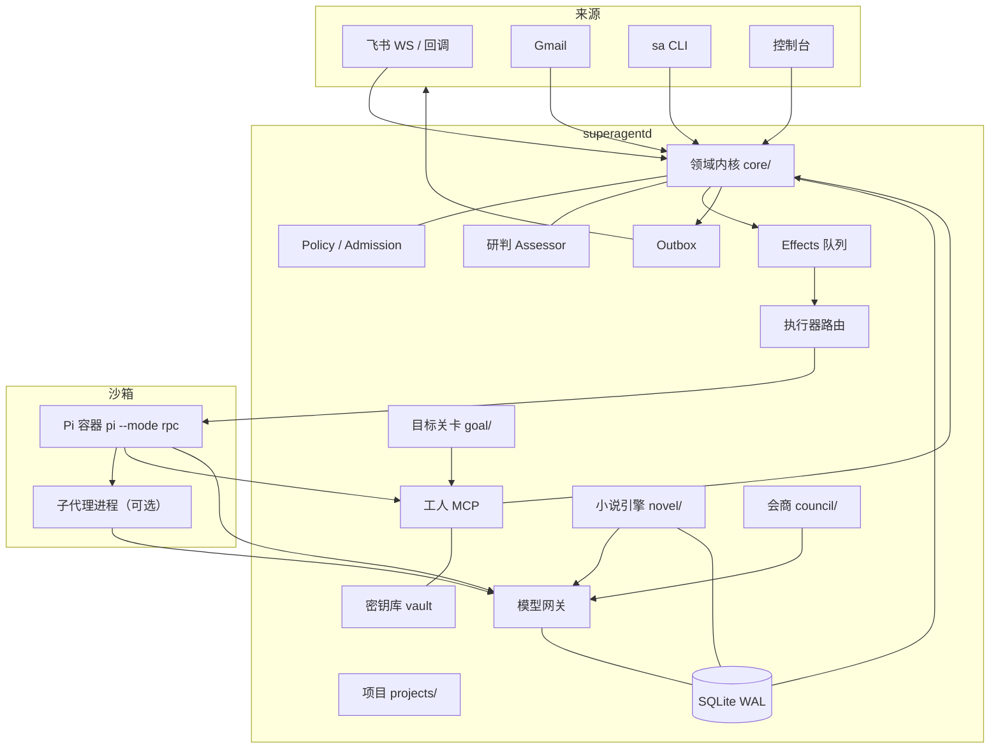

# 架构说明

这份文档面向想改代码或做安全评估的人，说明 superagent 的组件、数据流、状态布局和边界。功能与用法见 [`FEATURES.md`](FEATURES.md)。

## 1. 目标与非目标

**目标**

- 单操作者、单机自托管；一个守护进程管所有工单。
- 请求必须经过规则、授权和预算；执行必须在隔离沙箱里。
- 重启可恢复，所有关键动作可审计。
- 执行器、来源、模型和垂直流程都可以替换，不改领域内核。

**非目标**

- 多租户、组织隔离、SaaS 计费。
- 公网直接暴露；控制台默认只监听回环。
- 让模型决定流程；确定性的事情由代码决定。

## 2. 组件图



> 实线是主要调用方向。Pi 工人和它的子代理走本地网关，拿不到真实上游密钥；小说和目标判定由守护进程直接调用上游并按票记账；会商也直接调用，但账本票号为空，只受每日上限约束。

## 3. 一次请求的生命周期

```text
Source.receive
  → Engine.receive(trigger)
    → dedupe + gate
    → Eval（确定性 gate + 可选研判）
    → Decision / Mandate
    → Ticket
    → Assignment
    → Effect(ticket.launch)
      → Executor.launch
        → Pi 容器（或 NovelExecutor）
        → MCP / 网关
        → Report
      → Engine.report
    → Ticket 结束
  → Outbox → 原渠道
```

关键点：

- **只有 Eval 能开工单**。控制台、CLI、飞书、邮件和会商都走 `source.ask → engine.receive`，core 之外没有代码直接写 `tickets.save`。
- **Mandate 不可变**。规则版本、来源、范围、强度和发起人都记在工单上；后续设置变化不会悄悄扩大已开的票。
- **Effect 与命令同事务**。启动 worker、发消息等副作用先入队，事务提交后才执行；进程崩溃后可以恢复。
- **报告先过关卡**。设了目标时，`sa_report` 先交给 `GoalService.gate`，通过后才到 `Engine.report`。

## 4. 执行器

### 4.1 Pi 执行器

- 每张票一个容器，命令由 `launcher` 配置决定，默认 `pi --mode rpc --no-approve`。
- 每次启动生成随机票令牌，写入这张票的 `pi-config/<ticket>/`：
  - `models.json`：所有启用的服务商，指向网关，`apiKey` 是票令牌；
  - `mcp.json`：工人 MCP 端点；
  - `collab.json` + `extensions/sa-collab/index.ts`：开启协作时；
  - `goal.md`：设了目标时，通过 `--append-system-prompt` 告诉执行者。
- 执行器通过 RPC 读事件，写 `activity` 步骤；看门狗在长时间无输出时处理卡死。
- 任务结束时先关 stdin，再 SIGTERM，最后 SIGKILL；容器自行退出，不留下 `sa-*` 残留。

### 4.2 小说执行器

- 绑定书的票不走容器，由守护进程内的 `NovelExecutor` 执行。
- 它实现同一个 `Executor` 端口，只通过 `EngineForExecutor` 回报，所以授权、停止、追问和渠道规则不变。
- 每章是确定性状态机，每步落盘检查点；进程重启后从断点继续。
- 不执行 shell，不需要沙箱；模型调用直接走上游，按票记账。

### 4.3 执行器路由

`runtime.ts` 根据票是否绑定书选择执行器；两种执行器共享 effects、账本、outbox 和事件，但启动/交付使用不同的 effect kind（`novel.launch` / `novel.delivery`），互不占槽位。

## 5. 模型网关与令牌

- Pi 工人拿到的 `models.json` 里只有 `sa-<provider>` 和网关地址；真实密钥只存在于守护进程。
- 网关路由：`/p/<providerId>/<path>`；令牌解析出票和角色，查预算，替换成真实 key，转发请求体（保持上游前缀缓存），流式返回。
- 子代理令牌是 `<票令牌>.<角色>`：
  - 网关接受并记 `agent=<角色>`；
  - 工人 MCP 拒绝带后缀的令牌；
  - 同一张票共享预算，按角色分列花费。
- 超预算返回 `402 budget_exhausted`；上游错误也会记账（通常是 0 成本）。
- 图片过大时，网关会从最旧的图片开始替换成文本，避免 413。

## 6. 数据与状态

SQLite（WAL）保存领域数据、事件、账本和队列：

| 表/区域 | 内容 |
| --- | --- |
| `tickets` / `assignments` / `triggers` / `threads` | 工单、派工、触发和线程 |
| `events` | 机器做过的事 |
| `usage_calls` | 每次上游调用：票、角色、模型、token、缓存、延迟、美元 |
| `effects` | 持久化副作用队列，按 kind 并发和退避 |
| `outbox` | 待发送消息，按 message id 幂等 |
| `novel_*` | 书、章节、步骤、全文索引 |
| `ticket_goals` | 目标、轮数、上限和状态 |
| `collab_off` | 哪张票关闭了协作 |

`stateDir` 布局（默认 `.superagent`，生产在仓库外）：

```text
state/
  state.sqlite
  settings.json          # 受理规则
  options.json           # 模型、预算、飞书、邮箱、GitHub、小说、协作、目标等
  admin.json             # 管理口令哈希
  vault.json / vault.key # 加密后的密钥和主密钥
  cli-token              # CLI 令牌
  control.json           # 控制端口
  inbox/                 # 邮件收件缓存
  pi-config/<ticket>/    # 每票的模型、MCP、协作和提示词
  novels/<bookId>/       # 书、canon、章节、摘要、快照、工作文件
```

仓库外的默认目录：

- 工作区：`~/superagent-workspaces/`
- 项目库：`~/superagent-projects/`
- 备份：`~/superagent-backups/`

## 7. 安全边界

| 边界 | 机制 |
| --- | --- |
| 控制台 | 只监听 `127.0.0.1`；scrypt 口令哈希；会话；登录限流；CLI token |
| 控制端口 | 回环 + 随机端口；配置令牌后所有路由要求 Bearer |
| Worker 容器 | rootless、只读根、`no-new-privileges`、PID/CPU/内存限制；只放行网关和 MCP 两个端口 |
| 票令牌 | 随机、按 Assignment 生命周期；网关和 MCP 共用解析表，票结束即失效 |
| 子代理 | 令牌带角色后缀；看不到 `sa_*`；不能继续派活；写角色一次一个 |
| 密钥 | AES-256-GCM；主密钥来自 `SA_VAULT_KEY` 或 `state/vault.key`；只导出被授权的名字 |
| 出站文本 | 统一经过 vault 的脱敏器，密钥值不会进渠道、日志或事件 |
| GitHub | PAT 只在请求头；错误体擦除 token；仓库白名单 |
| 备份 | `VACUUM INTO` 一致快照；不含 `cli-token`、`pi-config/`、小说快照和工作文件 |

## 8. 可靠性与恢复

- **事务边界**：命令和 effect 入队同事务；提交后才执行副作用。
- **幂等**：trigger 去重、outbox 按 id、小说 commit 按 `lastChapter` 和 `commit.json`。
- **重启**：启动时重放未完成的 effects，恢复中断的 Assignment；小说从检查点继续。
- **看门狗**：Pi 长时间无输出会处理；目标检查期间用 `keepAlive` 重新计时，避免误杀。
- **备份**：启动时一次，之后每小时检查；最新超过 24 小时再备份；保留最新 7 份。

## 9. 扩展点

| 想改什么 | 从哪里下手 |
| --- | --- |
| 新来源 | 实现 `SourceScope` / `Source`，在 `runtime.ts` 注册；参考 `src/sources/` |
| 新执行器 | 实现 `Executor` 端口，走 `EngineForExecutor` 回报；参考 `src/novel/executor.ts` |
| 新模型协议 | 在 `src/gateway/gateway.ts` 加协议适配和价格表 |
| 新 MCP 工具 | 在 `src/mcp/worker-server.ts` 注册，更新 `WORKER_COMMANDS` |
| 新垂直流程 | 参照 `src/novel/`：自己的执行器 + 自己的服务 + 设置节 + API |
| 新协作角色 | 在 `src/executor/collab.ts` 改默认角色；控制台可覆盖 |
| 新控制台页面 | 在 `web/src/` 加页面和 API 调用，`pnpm build` 输出到 `src/admin/web-next/` |

## 10. 端口与设置

| 端口 | 用途 |
| --- | --- |
| `adminPort`（默认 8787，开发可 0） | 控制台和后台 API，只绑回环 |
| 控制端口（随机） | `sa` CLI 的控制接口，只绑回环 |
| 网关端口（随机） | Pi 工人调用模型 |
| MCP 端口（随机） | Pi 工人调用 `sa_*` 工具 |
| 19000–19199（可配） | 网页预览，每票最多 2 个 |

主要设置节：`executor`（镜像、CPU、内存、槽位）、`models`（服务商、模型、路由）、`budget`、`feishu`、`email`、`github`、`preview`、`projects`、`council`、`novel`、`collab`、`goal`。这些都在 `src/admin/options.ts` 的 zod schema 里，保存到 `state/options.json`。

## 11. 测试策略

- **单元/契约测试**：内核、规则、网关、来源、小说 schema、协作扩展、目标关卡。
- **端到端**：真实 runtime + 假 Pi（`tests/fixtures/fake-pi.mjs`）+ 假上游（`tests/fixtures/stub-upstream.mjs`），覆盖工单、目标、协作、小说和无容器路径。
- **控制台**：`tests/web-next-e2e.spec.ts` 对构建产物做静态和路由检查；`web/tests/app.test.tsx` 测 React 组件。
- **真实主机验收**：部署手册里的冒烟命令，以及在 Debian 上用真实 Pi 镜像跑任务。

## 12. 取舍

- **单机 SQLite**：够用、简单、可备份；不追求多机高可用。
- **每票一个容器**：隔离强，启动有成本；小说这种纯模型流程改为进程内执行。
- **网关只在 worker 路径**：保证工人拿不到密钥；小说和判定由守护进程直接调用并按票记账，会商直接调用但记在空票号上，减少一层转发。
- **规则在代码**：不靠提示词约束；代价是改规则要改 schema 和 UI。
- **确定性小说流水线**：章节质量和成本更可控；代价是题材和结构扩展需要改 schema。
